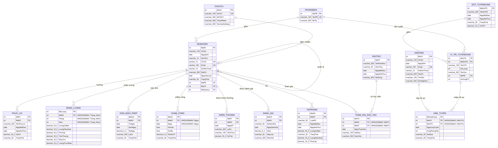

# ERD – Hệ thống CSDL quản lý nhân sự (IE103 – Nhóm 7)

Mô hình quan hệ của database `IE103_HRM_Nhom7`: 18 bảng, 18 khóa ngoại, đúng Database contract
của nhóm. Sinh tự động từ `Source/Website/src/config/contract.js`.

- Ảnh dùng cho báo cáo: [`ERD.png`](ERD.png)
- Mã nguồn Mermaid: [`ERD.mmd`](ERD.mmd) (sửa rồi dán vào https://mermaid.live để xuất lại ảnh)

Ký hiệu: `PK` khóa chính · `FK` khóa ngoại · `UK` UNIQUE một cột · `"UNIQUE(...)"` UNIQUE nhiều cột ·
`||--o{` một – nhiều (bắt buộc) · `|o--o{` một – nhiều (không bắt buộc).

## Quan hệ

| Bảng cha (1) | Bảng con (N) | Khóa ngoại | Ý nghĩa |
|---|---|---|---|
| PHONGBAN | NHANVIEN | `NHANVIEN.MaPB` | Một phòng ban gồm nhiều nhân viên; mỗi nhân viên thuộc đúng một phòng ban |
| CHUCVU | NHANVIEN | `NHANVIEN.MaCV` | Một chức vụ do nhiều nhân viên đảm nhiệm |
| NHANVIEN | NHANVIEN | `NHANVIEN.MaQuanLy` | Một nhân viên quản lý trực tiếp nhiều nhân viên; người đứng đầu không có quản lý (NULL) |
| NHANVIEN | HOPDONG | `HOPDONG.MaNV` | Một nhân viên ký nhiều hợp đồng theo thời gian |
| DOT_TUYENDUNG | VI_TRI_TUYENDUNG | `VI_TRI_TUYENDUNG.MaDotTD` | Một đợt tuyển dụng gồm nhiều vị trí |
| PHONGBAN | VI_TRI_TUYENDUNG | `VI_TRI_TUYENDUNG.MaPB` | Một phòng ban cần tuyển nhiều vị trí |
| UNGVIEN | UNG_TUYEN | `UNG_TUYEN.MaUV` | Một ứng viên nộp hồ sơ nhiều vị trí (mỗi vị trí một lần) |
| VI_TRI_TUYENDUNG | UNG_TUYEN | `UNG_TUYEN.MaViTri` | Một vị trí nhận nhiều hồ sơ |
| NHANVIEN | THAM_GIA_DAO_TAO | `THAM_GIA_DAO_TAO.MaNV` | Một nhân viên tham gia nhiều khóa (mỗi khóa một lần) |
| DAOTAO | THAM_GIA_DAO_TAO | `THAM_GIA_DAO_TAO.MaDT` | Một khóa đào tạo có nhiều học viên |
| NHANVIEN | DANH_GIA | `DANH_GIA.MaNV` | Một nhân viên được đánh giá mỗi tháng một lần |
| DANH_GIA | DANH_GIA_CHI_TIET | `DANH_GIA_CHI_TIET.MaDG` | Một lần đánh giá gồm nhiều KPI thành phần (PK kép MaDG, STT) |
| NHANVIEN | KHEN_THUONG | `KHEN_THUONG.MaNV` | Một nhân viên được khen thưởng nhiều lần |
| NHANVIEN | CHAM_CONG | `CHAM_CONG.MaNV` | Mỗi ngày một bản ghi chấm công / nhân viên |
| NHANVIEN | DON_NGHI_PHEP | `DON_NGHI_PHEP.MaNV` | Một nhân viên nộp nhiều đơn nghỉ phép |
| NHANVIEN | BANG_LUONG | `BANG_LUONG.MaNV` | Mỗi tháng một bảng lương / nhân viên |
| NHANVIEN | PHUC_LOI | `PHUC_LOI.MaNV` | Một nhân viên hưởng nhiều phúc lợi |
| DS_PHUC_LOI | PHUC_LOI | `PHUC_LOI.MaLoaiPL` | Một loại phúc lợi được áp dụng cho nhiều nhân viên |

`UNG_TUYEN` và `THAM_GIA_DAO_TAO` là bảng trung gian của hai quan hệ nhiều – nhiều
(ỨNG VIÊN – VỊ TRÍ, NHÂN VIÊN – KHÓA ĐÀO TẠO), mang thêm thuộc tính của quan hệ (vòng phỏng vấn, kết quả…).

## Mermaid

```mermaid
erDiagram
    PHONGBAN {
        int MaPB PK
        nvarchar_100 TenPB UK
        nvarchar_300 MoTa
    }
    CHUCVU {
        int MaCV PK
        nvarchar_100 TenCV UK
        nvarchar_300 MoTaCV
        nvarchar_300 TrachNhiem
        nvarchar_300 YeuCauKyNang
    }
    NHANVIEN {
        int MaNV PK
        nvarchar_100 HoTen
        date NgaySinh
        nvarchar_10 GioiTinh
        varchar_12 CCCD UK
        varchar_100 Email UK
        varchar_15 SoDienThoai
        nvarchar_200 DiaChi
        date NgayVaoLam
        nvarchar_30 TrangThai
        int MaPB FK
        int MaCV FK
        int MaQuanLy FK
    }
    HOPDONG {
        int MaHD PK
        int MaNV FK
        nvarchar_50 LoaiHD
        date NgayBatDau
        date NgayKetThuc
        decimal_18_2 LuongCoBan
        nvarchar_30 TrangThai
        decimal_18_2 LuongHieuSuat
        decimal_18_2 PhuCap
    }
    DOT_TUYENDUNG {
        int MaDotTD PK
        nvarchar_200 TenDotTD
        date NgayBatDau
        date NgayKetThuc
        nvarchar_30 TrangThai
        decimal_18_2 ChiPhi
    }
    VI_TRI_TUYENDUNG {
        int MaViTri PK
        int MaDotTD FK
        nvarchar_100 TenViTri
        int SoLuong
        nvarchar_500 YeuCau
        int MaPB FK
        int SoVongPV
    }
    UNGVIEN {
        int MaUV PK
        nvarchar_100 HoTen
        date NgaySinh
        varchar_100 Email UK
        varchar_15 SoDienThoai
        nvarchar_200 DiaChi
        nvarchar_100 TrinhDo
        nvarchar_500 KinhNghiem
    }
    UNG_TUYEN {
        int MaUngTuyen PK
        int MaUV FK "UNIQUE(MaUV, MaViTri)"
        int MaViTri FK "UNIQUE(MaUV, MaViTri)"
        date NgayUngTuyen
        int VongPhongVan
        nvarchar_30 KetQua
        nvarchar_30 TrangThai
    }
    DAOTAO {
        int MaDT PK
        nvarchar_200 TenKhoaHoc
        nvarchar_30 HinhThuc
        date NgayBatDau
        date NgayKetThuc
        nvarchar_500 NoiDung
    }
    THAM_GIA_DAO_TAO {
        int MaTG PK
        int MaNV FK "UNIQUE(MaNV, MaDT)"
        int MaDT FK "UNIQUE(MaNV, MaDT)"
        date NgayThamGia
        nvarchar_100 KetQua
        nvarchar_300 DanhGia
    }
    DANH_GIA {
        int MaDG PK
        int MaNV FK "UNIQUE(MaNV, Thang, Nam)"
        int Thang "UNIQUE(MaNV, Thang, Nam)"
        int Nam "UNIQUE(MaNV, Thang, Nam)"
        date NgayDanhGia
        decimal_6_2 HieuSuatKPITong
        nvarchar_30 XepLoai
        nvarchar_500 NhanXet
    }
    DANH_GIA_CHI_TIET {
        int MaDG PK, FK
        int STT PK
        nvarchar_200 TenKPI
        decimal_18_2 KPIMucTieu
        decimal_18_2 KPIThucTe
        decimal_5_2 TrongSo
        decimal_6_2 HieuSuatKPI
    }
    KHEN_THUONG {
        int MaKT PK
        int MaNV FK
        date NgayKT
        nvarchar_300 LyDo
        nvarchar_100 HinhThuc
        decimal_18_2 SoTien
    }
    CHAM_CONG {
        int MaCC PK
        int MaNV FK "UNIQUE(MaNV, Ngay)"
        date Ngay "UNIQUE(MaNV, Ngay)"
        time GioVao
        time GioRa
        decimal_5_2 SoGioOT
        nvarchar_30 TrangThai
    }
    DON_NGHI_PHEP {
        int MaDon PK
        int MaNV FK
        date TuNgay
        date DenNgay
        decimal_5_2 SoNgay
        nvarchar_300 LyDo
        nvarchar_30 TrangThai
    }
    BANG_LUONG {
        int MaLuong PK
        int MaNV FK "UNIQUE(MaNV, Thang, Nam)"
        int Thang "UNIQUE(MaNV, Thang, Nam)"
        int Nam "UNIQUE(MaNV, Thang, Nam)"
        decimal_18_2 LuongCoBan
        decimal_18_2 LuongHieuSuat
        decimal_18_2 PhuCap
        decimal_18_2 TienThuong
        decimal_18_2 KhauTru
        decimal_18_2 LuongThucNhan
    }
    DS_PHUC_LOI {
        int MaLoaiPL PK
        nvarchar_200 TenPhucLoi UK
        nvarchar_500 ChiTiet
        nvarchar_30 TrangThai
    }
    PHUC_LOI {
        int MaPL PK
        int MaNV FK
        int MaLoaiPL FK
        date NgayBatDau
        date NgayKetThuc
        decimal_18_2 GiaTri
    }
    PHONGBAN ||--o{ NHANVIEN : "gồm"
    CHUCVU ||--o{ NHANVIEN : "đảm nhiệm"
    NHANVIEN |o--o{ NHANVIEN : "quản lý"
    NHANVIEN ||--o{ HOPDONG : "ký"
    DOT_TUYENDUNG ||--o{ VI_TRI_TUYENDUNG : "gồm"
    PHONGBAN ||--o{ VI_TRI_TUYENDUNG : "cần tuyển"
    UNGVIEN ||--o{ UNG_TUYEN : "nộp hồ sơ"
    VI_TRI_TUYENDUNG ||--o{ UNG_TUYEN : "nhận hồ sơ"
    NHANVIEN ||--o{ THAM_GIA_DAO_TAO : "tham gia"
    DAOTAO ||--o{ THAM_GIA_DAO_TAO : "có học viên"
    NHANVIEN ||--o{ DANH_GIA : "được đánh giá"
    DANH_GIA ||--o{ DANH_GIA_CHI_TIET : "gồm KPI"
    NHANVIEN ||--o{ KHEN_THUONG : "được khen thưởng"
    NHANVIEN ||--o{ CHAM_CONG : "chấm công"
    NHANVIEN ||--o{ DON_NGHI_PHEP : "nộp đơn"
    NHANVIEN ||--o{ BANG_LUONG : "nhận lương"
    NHANVIEN ||--o{ PHUC_LOI : "hưởng"
    DS_PHUC_LOI ||--o{ PHUC_LOI : "được áp dụng"

```

